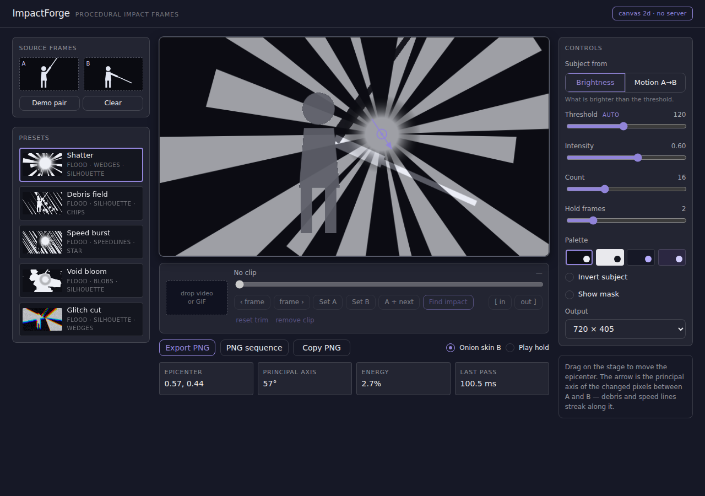

# ImpactForge

A browser tool that turns a pair of animation frames into an anime-style
impact frame — the "hit" flash you see between action beats. Everything is
generated procedurally with Canvas 2D: no server, no image model, no
build step. Open `index.html` and it runs.



## Try it

Open [`index.html`](index.html) directly in a browser, or serve the repo
and visit it — either works, since the whole app is one static file with
no dependencies. Pushed to `main`, it also serves as-is from GitHub Pages.

## How it works

1. **Load a source.** Drop two stills into the **A** / **B** boxes (A is
   the subject, B is a moment later), drop a video clip or animated GIF
   below the stage and hit **Find impact** to auto-pick the peak moment,
   or click **Demo pair** to try the built-in example.
2. **Shape it.** Pick a preset on the left — each is a data-driven stack
   of layers (flood fill, silhouette, wedges, chips, speed lines, a core
   glow, and more) drawn from one shared layer catalogue. **Threshold**
   decides what counts as the subject; **Intensity** and **Count** scale
   shard size and density; palette swatches restyle the whole frame.
   Drag on the stage to move the epicenter — the arrow shows the motion
   axis measured between A and B, and debris/speed lines streak along it.
3. **Export.** **Export PNG** saves the current frame, **PNG sequence**
   exports one file per hold frame (for a few frames of animation to cut
   to), and **Copy PNG** puts the current frame on the clipboard.

### Masking modes

- **Brightness** — threshold on luminance; the classic "what's bright"
  read.
- **Motion A→B** — the mask is the blurred difference between frames A
  and B, isolating what actually moved rather than what happens to be
  bright. Falls back to brightness if only one frame is loaded.

Both support **auto** (Otsu thresholding) and a **Show mask** overlay so
you can see exactly what the threshold is catching while you drag it.

### Video and GIF

Drop a clip or animated GIF on the small zone under the stage to scrub,
step frame-by-frame, and grab A/B, or let **Find impact** scan the clip
for the largest frame-to-frame change and set the pair (and the
threshold) automatically. **[ in** / **out ]** trim the working range so
scanning and scrubbing stay inside the part of the clip you care about.

## Pipeline

Every stage caches so a slider drag only recomputes what actually
changed:

```
resample → luminance (cached) → mask (threshold-only rerun) → diff
  (centroid + principal axis between A and B) → composite (walk the
  preset's layers) → hold (reseeded copies for a short sequence)
```

Presets are pure JSON over one layer catalogue (`flood`, `silhouette`,
`wedges`, `star`, `blobs`, `chips`, `speedLines`, `core`, `rgbSplit`,
`scanlines`, `grain`) — adding a style is a new entry, never new render
code.

## Repo layout

- `index.html` — the app. Single file, no dependencies, no build.
- `project/` — the original design source from Claude Design (the
  `.dc.html` component, design tokens, and the design tool's runtime
  shim) kept for reference and future editing in that tool. It is not
  used by `index.html`.
- `chats/` — the design conversation transcripts this build was
  implemented from.

## License

MIT — see [LICENSE](LICENSE).
